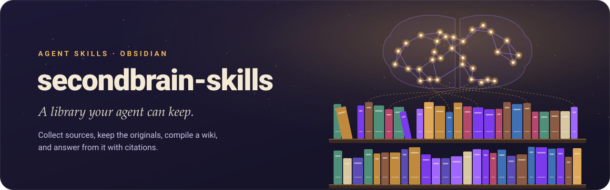
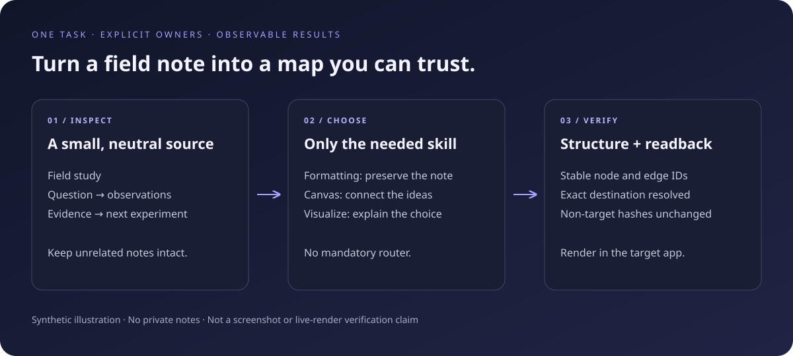

<p align="center">
  
</p>

<p align="center">
  <a href="https://github.com/GoBeromsu/secondbrain-skills/actions/workflows/validate.yml"></a>
  <a href="https://github.com/GoBeromsu/secondbrain-skills/releases"></a>
  <a href="LICENSE"></a>
  <a href="https://agentskills.io"></a>
  <a href="CODE_OF_CONDUCT.md"></a>
</p>

<p align="center">
  <a href="README.md">English</a> · <b>한국어</b>
  <br>
  <a href="#빠른-시작">빠른 시작</a> · <a href="#동작-방식">동작 방식</a> · <a href="#패키지">패키지</a> · <a href="#설치">설치</a> · <a href="#기여하기">기여하기</a> · <a href="#감사의-말">감사의 말</a>
</p>

**secondbrain-skills**는 사서가 도서관을 꾸리듯 에이전트가 Obsidian 볼트를 꾸리게 해 주는 Agent Skill 모음입니다. 자료는 반납함으로 들어오고, 원문은 손대지 않은 채 서고에 보존되며, 그 원문으로 위키라는 목록을 엮고, 질문에는 열람실에서 서가의 출처를 달아 답합니다.

패키지 하나는 한 가지 일을 맡는 `SKILL.md` 하나입니다. 루트 스킬도, 디스패처도, 공유 런타임도 없습니다. 에이전트는 그 작업에 필요한 패키지만 불러옵니다.

## 빠른 시작

```sh
claude plugin marketplace add GoBeromsu/secondbrain-skills
claude plugin install secondbrain-skills@secondbrain-skills
```

그다음에는 평소 말로 시키면 됩니다.

> *"이 탭들 capture 해줘."* · *"이 글 ingest 해줘."* · *"내 볼트에 간격 반복에 대해 뭐라고 적혀 있어?"* · *"AI 폴더 lint 해줘."*

다른 런타임은 [설치](#설치)를 보십시오.

## 동작 방식

<p align="center">
  
</p>

| 원칙 | 실제로 뜻하는 것 |
| --- | --- |
| **판단은 스킬이 맡습니다.** | 무엇을 고르고, 어떻게 분류하고, 언제 멈출지는 Markdown에 적습니다. 스크립트는 질문 하나에만 답하고 실행을 막지 않습니다. |
| **원문은 남습니다.** | 자료에 대해 무엇을 쓰기 전에 먼저 Raw 노트로 원문 그대로 보존합니다. |
| **형식을 안다고 써도 되는 것은 아닙니다.** | 패키지는 작업이 허락한 정확한 위치에만 쓰고, 쓴 결과를 다시 읽습니다. |
| **증거가 없으면 성공이 아닙니다.** | 파싱은 렌더링이 아니고, 종료 코드는 쓰기의 증거가 아닙니다. 패키지는 어느 수준까지 확인했는지 밝힙니다. |

## 패키지

독립된 패키지 스무 개입니다. 각 행은 그 패키지를 정의하는 `SKILL.md`로 이어지고, 에이전트는 그 `description`을 보고 패키지를 고릅니다.

| 서가 | 패키지 | 맡는 일 |
| --- | --- | --- |
| **모으기** | [`capture`](skills/capture/SKILL.md) | 탭, URL, 파일, 대화, 에이전트 세션을 Inbox 후보로 저장합니다. |
| | [`inbox`](skills/inbox/SKILL.md) | Inbox를 검토하고 고른 범위를 `ingest`로 보냅니다. |
| **엮기** | [`ingest`](skills/ingest/SKILL.md) | 자료 하나를 보존된 Raw 노트와 위키 페이지, Entity, Map으로 만듭니다. |
| | [`onboard`](skills/onboard/SKILL.md) | 새 볼트를 소유자 인터뷰로 세팅하거나 기존 볼트를 진단합니다. |
| | [`refresh-context`](skills/refresh-context/SKILL.md) | 에이전트가 소유자에 대해 쥐고 있는 Core Context를 새로 고칩니다. |
| | [`reindex`](skills/reindex/SKILL.md) | 노트가 바뀐 뒤 qmd 검색 색인을 새로 고칩니다. |
| **묻기** | [`query`](skills/query/SKILL.md) | 위키에서 출처를 달아 답하고, 빈 곳을 위키로 되돌립니다. |
| **서가 관리** | [`lint`](skills/lint/SKILL.md) | 링크, 위치, frontmatter, 색인·로그 동기화 같은 기계적 건강 검사. |
| | [`audit`](skills/audit/SKILL.md) | Map 묶음별로 위키 페이지를 표본 추출해 품질을 매깁니다(읽기 전용). |
| | [`verify`](skills/verify/SKILL.md) | 한 페이지의 주장을 인용한 증거와 대조합니다. |
| | [`status`](skills/status/SKILL.md) | 개수, 밀린 작업, 커버리지를 읽기 전용으로 보여 줍니다. |
| **원칙** | [`principle-archival`](skills/principle-archival/SKILL.md) | 출처(provenance), 원질서, 컬렉션 전체를 기술하는 법. |
| | [`principle-formatting`](skills/principle-formatting/SKILL.md) | Obsidian 볼트에서 Markdown을 쓰는 법. |
| | [`principle-knowledge-notes`](skills/principle-knowledge-notes/SKILL.md) | 노트의 종류(Term, Concept, Guide, Entity)와 템플릿을 정합니다. |
| | [`principle-writing`](skills/principle-writing/SKILL.md) | 글을 쓰고, 요약하고, 번역하고, 검토하는 법. |
| **Obsidian** | [`bases`](skills/bases/SKILL.md) | Obsidian Bases: `.base` 파일과 임베드된 base 블록. |
| | [`obsidian-cli`](skills/obsidian-cli/SKILL.md) | 공식 `obsidian` CLI로 실행 중인 데스크톱 앱을 다룹니다. |
| | [`obsidian-clipper`](skills/obsidian-clipper/SKILL.md) | Web Clipper 템플릿 JSON을 쓰고 고칩니다. |
| | [`obsidian-sync`](skills/obsidian-sync/SKILL.md) | `ob` 클라이언트로 하는 헤드리스 Obsidian Sync. |
| | [`obsidian-visualize`](skills/obsidian-visualize/SKILL.md) | JSON Canvas, Excalidraw, Pele mermaid 시각화. |

## 설치

각 런타임의 공식 플러그인·스킬 레지스트리로 설치하고, 업데이트도 같은 경로로 합니다. 이 저장소는 설치 스크립트를 제공하지 않습니다. 플러그인과 함께 스킬 디렉터리에 복사본을 두면 복사본이 플러그인을 가립니다.

<details open>
<summary><b>Claude Code</b></summary>

```sh
claude plugin marketplace add GoBeromsu/secondbrain-skills
claude plugin install secondbrain-skills@secondbrain-skills
# 업데이트
claude plugin marketplace update secondbrain-skills
claude plugin update secondbrain-skills@secondbrain-skills
```
</details>

<details>
<summary><b>Codex</b></summary>

```sh
codex plugin marketplace add GoBeromsu/secondbrain-skills
codex plugin add secondbrain-skills@secondbrain-skills
# 업데이트
codex plugin marketplace upgrade secondbrain-skills
codex plugin add secondbrain-skills@secondbrain-skills
```
</details>

<details>
<summary><b>GJC</b></summary>

```sh
gjc plugin marketplace add GoBeromsu/secondbrain-skills
gjc plugin install secondbrain-skills@secondbrain-skills
# 업데이트
gjc plugin marketplace update secondbrain-skills
gjc plugin upgrade secondbrain-skills@secondbrain-skills
```
</details>

<details>
<summary><b>Grok Build</b></summary>

```sh
grok plugin marketplace add GoBeromsu/secondbrain-skills
```

설치와 업데이트는 Marketplace 탭에서 합니다.
</details>

<details>
<summary><b>Hermes</b></summary>

```sh
hermes plugins install GoBeromsu/secondbrain-skills --enable
```

portable 플러그인이며 스킬은 `<namespace>:<name>`으로 불리고, `plugins.auto_apply: true`면 자동으로 업데이트됩니다. Hermes에는 `v0.1.0` 태그를 설치하지 마십시오.
</details>

<details>
<summary><b>그 밖의 런타임</b> (Cursor, 일반 Agent Skills, Aside)</summary>

플러그인 레지스트리가 없는 런타임은 스킬 디렉터리의 `skills/<name>/` 폴더를 읽습니다. 그 런타임이 문서화한 가져오기 방법을 쓰십시오. Aside는 `<account root>/skills/user/<name>/SKILL.md`를 읽습니다.
</details>

## 검증된 것

모든 push와 pull request는 CI에서 [`validate`](.github/workflows/validate.yml)를 돌립니다.

| 검사 | 도구 |
| --- | --- |
| 플러그인 형식 | `claude plugin validate . --strict` |
| 매니페스트가 파싱되고 이름과 버전이 모두 같은지 | [`scripts/validate.py`](scripts/validate.py) |
| `skills/<name>/SKILL.md`의 frontmatter `name`이 폴더 이름과 같고 description이 1,024자 이내인지 | `scripts/validate.py` |
| 모든 패키지가 두 README에 실려 있고 상대 링크가 모두 이어지는지 | `scripts/validate.py` |
| 모든 이미지가 [에셋 원장](assets/asset-ledger.json)에 기록됐는지, SVG에 스크립트·외부 참조가 없는지, 아이콘이 정사각형 PNG인지 | `scripts/validate.py` |
| 함께 싣는 스크립트가 컴파일되고 `link-lint.py`가 [평가셋](evals/lint-links)을 그대로 재현하는지 | `scripts/validate.py` |

같은 검사를 로컬에서 `python3 scripts/validate.py`로 돌릴 수 있습니다. 모두 정적 검사이며 런타임 로드를 주장하지 않습니다. 변경을 무엇에 대해 실행했는지는 그 변경의 커밋 메시지에 적습니다.

릴리스: `main`에서 `scripts/release.sh <version>`을 실행하면 모든 매니페스트의 버전을 맞추고(스킬에는 버전이 없습니다), 검증기를 돌리고, 태그를 달아 push한 뒤 프리릴리스를 게시합니다.

## 기여하기

이슈와 pull request를 환영합니다. 패키지 하나에 일 하나, 판단은 스크립트가 아니라 Markdown에 두기를 지켜 주시고, push 전에 `python3 scripts/validate.py`를 돌려 주십시오.

참여하는 모든 분은 [행동 강령](CODE_OF_CONDUCT.md)(Contributor Covenant 2.1)을 따라 주십시오.

## 감사의 말

이 도서관은 다른 사람들의 서가 위에 서 있습니다. 아래 어느 것도 보증이나 제휴를 뜻하지 않으며, 원 저작물의 허가 고지 전문은 [NOTICE](NOTICE)에 있습니다.

| 출처 | 쓰인 곳 | 어떻게 |
| --- | --- | --- |
| [Steph Ango (kepano), obsidian-skills](https://github.com/kepano/obsidian-skills) · MIT | `principle-formatting`, `bases`, `obsidian-cli`, `obsidian-visualize`의 JSON Canvas 레퍼런스 | 여기서 출발해 수정했습니다 |
| [구요한 (Yohan Koo), cmds-llm-wiki](https://github.com/johnfkoo951/cmds-llm-wiki) · 라이선스 미공개 | 지식 패키지 | 그의 명령에서 출발했고, 지금은 이 저장소가 정본이며 소유자의 결정에 따라 달라졌습니다. 원 저장소 파일은 싣지 않았고 재라이선스하지 않습니다 |
| [Andrej Karpathy](https://github.com/karpathy) | 지식 패키지 | cmds-llm-wiki가 바탕으로 삼은 LLM Wiki 패턴 |
| [기록학 16주 완성](https://wikidocs.net/25577), ICA *ISAD(G)* 제2판(2000), T. R. 셸렌버그 *Modern Archives*(1956) | `principle-archival` | 영어로 새롭게 작성한 독자적 응용이며 원문 재현이 아닙니다 |
| [Jonghak Seo, pi-extension](https://github.com/Jonghakseo/pi-extension) · MIT | `obsidian-visualize` | 검사 린트, 팔레트·간격 지침을 가져와 고쳤습니다 |
| [Obsidian, Pele](https://github.com/obsidianmd/pele) · MIT | `obsidian-visualize` | Pele 분기는 공개된 호환성·보안 문서를 따릅니다. Pele 파일은 싣지 않습니다 |
| [구요한 (Yohan Koo), CMDSPACE Pele 갤러리](https://pele.cmdspace.work/) | `obsidian-visualize` | 쓸 때·피할 때·크기 한도와 관찰된 함정을 참고했고, 예제는 모두 직접 썼습니다 |
| [coleam00, excalidraw-diagram-skill](https://github.com/coleam00/excalidraw-diagram-skill) · 라이선스 파일 없음 | `obsidian-visualize` | 아이디어를 Excalidraw 디자인 지침에 다시 표현했고, 복사한 것은 없습니다 |
| [Zsolt Viczian, Excalidraw 플러그인](https://github.com/zsviczian/obsidian-excalidraw-plugin) · AGPL-3.0, Excalidraw Extras · 라이선스 미확인 | `obsidian-visualize` | API 사실 확인용으로만 읽었고, 코드와 문장은 복사하지 않았습니다 |
| [Excalidraw, excalidraw-libraries](https://github.com/excalidraw/excalidraw-libraries) · MIT | `obsidian-visualize` | 디자인 아이디어만 참고했습니다 |
| [robtaylor, Excalidraw 예제 모음](https://robtaylor.github.io/excalidraw-diagrams/) · 라이선스 미확인 | `obsidian-visualize` | 아이디어만 참고했고, 복사한 것은 없습니다 |
| [Anthropic, skill-creator](https://github.com/anthropics/skills/tree/main/skills/skill-creator)와 [Claude Fable 5.2 프롬프팅 가이드](https://platform.claude.com/docs/ko/build-with-claude/prompt-engineering/prompting-claude-fable-5-2) | `obsidian-visualize`, `principle-archival`, `principle-formatting`, `principle-writing` | 출처 이미지·링크·텍스트 분량 지침을 어떻게 쓸지 참고했고, 복사한 것은 없습니다 |
| [GMU Writing Center](https://writingcenter.gmu.edu/writing-resources/general-writing-practices/cohesion-and-coherence), [Purdue OWL](https://owl.purdue.edu/owl/subject_specific_writing/professional_technical_writing/audience_analysis/index.html), [맨체스터 대학교 Academic Phrasebank](https://www.phrasebank.manchester.ac.uk/using-cautious-language/), Google [Technical Writing One](https://developers.google.com/tech-writing/one/words)과 [개발자 문서 스타일 가이드](https://developers.google.com/style/lists) | `principle-writing` | 참고했고, 문장은 모두 직접 썼습니다 |

"Obsidian"은 이 스킬들이 대상으로 하는 서드파티 애플리케이션의 이름이며, 제휴 관계를 주장하지 않습니다.

## 라이선스

[MIT](LICENSE). 원 저작물의 허가 고지는 [NOTICE](NOTICE)에 있습니다. `assets/`의 그림은 모두 직접 제작한 원본으로 [에셋 원장](assets/asset-ledger.json)에 기록되어 있으며, 스크린샷은 하나도 없습니다.
