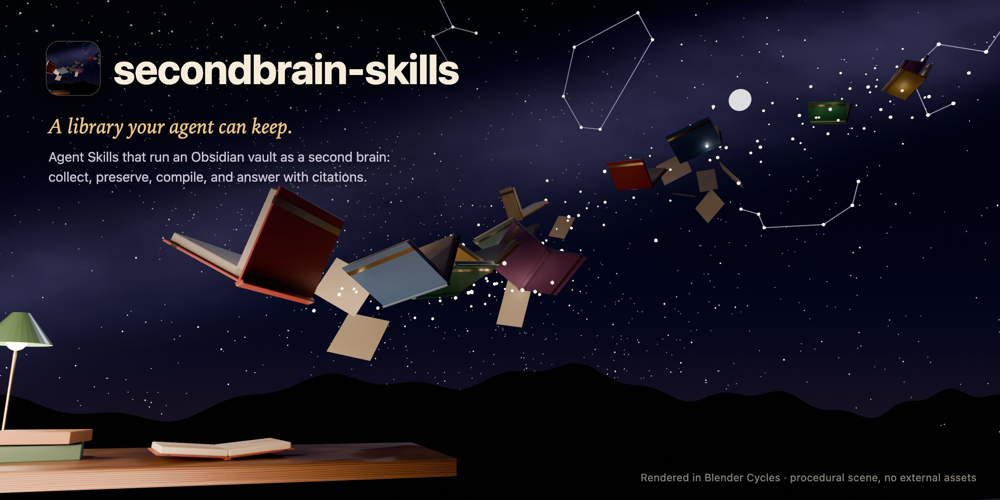

<p align="center">
  
</p>

<p align="center">
  <a href="https://github.com/GoBeromsu/secondbrain-skills/actions/workflows/validate.yml"></a>
  <a href="https://github.com/GoBeromsu/secondbrain-skills/releases"></a>
  <a href="LICENSE"></a>
  <a href="https://agentskills.io"></a>
  <a href="CODE_OF_CONDUCT.md"></a>
</p>

<p align="center">
  <a href="README.md">English</a> · <b>한국어</b>
  <br>
  <a href="#빠른-시작">빠른 시작</a> · <a href="#동작-방식">동작 방식</a> · <a href="#패키지">패키지</a> · <a href="#설치">설치</a> · <a href="CONTRIBUTING.md">기여하기</a> · <a href="ACKNOWLEDGEMENTS.md#감사의-말">감사의 말</a>
</p>

**secondbrain-skills**는 사서가 도서관을 꾸리듯 에이전트가 Obsidian 볼트를 꾸리고, 그 안의 지식을 서로 잇게 해 주는 Agent Skill 모음입니다. 자료는 반납함으로 들어오고 원문은 손대지 않은 채 서고에 보존됩니다. 그 원문으로 엮은 페이지는 관련된 페이지, 인물, 저작과 하나하나 연결되어, 흩어진 노트가 하나의 별자리처럼 읽히게 됩니다. 질문에는 그 연결을 따라가며 서가의 출처를 달아 답합니다.

세컨드 브레인은 노트 더미가 아니라 노트 사이의 연결입니다. 이 스킬들은 그 연결을 만들고 지킵니다.

패키지 하나는 한 가지 일을 맡는 `SKILL.md` 하나입니다. 루트 스킬도, 공유 런타임도 없습니다. 디스패처는 직접 켤 때만 도는 `secondbrain-mode` 하나입니다. 에이전트는 그 작업에 필요한 패키지만 불러옵니다.

## 빠른 시작

```sh
claude plugin marketplace add GoBeromsu/secondbrain-skills
claude plugin install secondbrain-skills@secondbrain-skills
```

> [!TIP]
> 그다음에는 평소 말로 시키면 됩니다. *"이 탭들 capture 해줘."* · *"이 글 ingest 해줘."* · *"내 볼트에 간격 반복에 대해 뭐라고 적혀 있어?"* · *"AI 폴더 lint 해줘."*

다른 런타임은 [설치](#설치)를 보십시오.

## 동작 방식

<p align="center">
  
</p>

| 원칙 | 실제로 뜻하는 것 |
| --- | --- |
| **판단은 스킬이 맡습니다.** | 무엇을 고르고, 어떻게 분류하고, 언제 멈출지는 Markdown에 적습니다. 스크립트는 질문 하나에만 답하고 실행을 막지 않습니다. |
| **원문은 남습니다.** | ingest 하거나 저장하라고 건넨 자료는 무엇을 쓰기 전에 먼저 Raw 노트로 원문 그대로 보존합니다. 조사하며 읽은 웹 페이지는 링크로만 남습니다. |
| **형식을 안다고 써도 되는 것은 아닙니다.** | 패키지는 작업이 허락한 정확한 위치에만 쓰고, 쓴 결과를 다시 읽습니다. |
| **증거가 없으면 성공이 아닙니다.** | 파싱은 렌더링이 아니고, 종료 코드는 쓰기의 증거가 아닙니다. 패키지는 어느 수준까지 확인했는지 밝힙니다. |

## 패키지

독립된 패키지 마흔한 개입니다. 각 행은 그 패키지를 정의하는 `SKILL.md`로 이어지고, 에이전트는 그 `description`을 보고 패키지를 고릅니다. `principle-*` 원칙은 스스로 불리지 않고, 패키지의 단계나 `secondbrain-mode`가 이름을 댈 때 읽힙니다.

| 서가 | 패키지 | 맡는 일 |
| --- | --- | --- |
| **모으기** | [`capture`](skills/capture/SKILL.md) | 탭, URL, 파일, 대화, 에이전트 세션을 Inbox 후보로 저장합니다. |
| | [`inbox`](skills/inbox/SKILL.md) | Inbox를 검토하고 고른 범위를 `ingest`로 보냅니다. |
| **엮기** | [`ingest`](skills/ingest/SKILL.md) | 자료 하나를 보존된 Raw 노트와 위키 페이지, Entity, Map으로 만듭니다. |
| | [`onboard`](skills/onboard/SKILL.md) | 새 볼트를 소유자 인터뷰로 세팅하거나 기존 볼트를 진단합니다. |
| | [`refresh-context`](skills/refresh-context/SKILL.md) | 에이전트가 소유자에 대해 쥐고 있는 Core Context를 새로 고칩니다. |
| | [`reindex`](skills/reindex/SKILL.md) | 노트가 바뀐 뒤 qmd 검색 색인을 새로 고칩니다. |
| | [`term`](skills/term/SKILL.md) | 분야 용어를 조사해 Term 페이지를 쓰거나 고칩니다. |
| | [`concept`](skills/concept/SKILL.md) | 아이디어나 방법론을 조사해 Concept 페이지를 쓰거나 고칩니다. |
| | [`entity`](skills/entity/SKILL.md) | 이름 있는 대상을 조사해 타입별 템플릿으로 Entity 페이지를 쓰거나 고칩니다. |
| **묻기** | [`query`](skills/query/SKILL.md) | 위키에서 출처를 달아 답하고, 빈 곳을 위키로 되돌립니다. |
| **모드** | [`secondbrain-mode`](skills/secondbrain-mode/SKILL.md) | 켜 두면 새 단어, 방법론, 이름 있는 대상을 백그라운드에서 위키에 쓰고 한 줄로 보고합니다. |
| **서가 관리** | [`lint`](skills/lint/SKILL.md) | 링크, 위치, frontmatter, 색인·로그 동기화 같은 기계적 건강 검사. |
| | [`audit`](skills/audit/SKILL.md) | Map 묶음별로 위키 페이지를 표본 추출해 품질을 매깁니다(읽기 전용). |
| | [`verify`](skills/verify/SKILL.md) | 한 페이지의 주장을 인용한 증거와 대조합니다. |
| | [`status`](skills/status/SKILL.md) | 개수, 밀린 작업, 커버리지를 읽기 전용으로 보여 줍니다. |
| **원칙** | [`principle-vault-roles`](skills/principle-vault-roles/SKILL.md) | 볼트의 wiki, source, work 영역마다 허용되는 쓰기를 정합니다. |
| | [`principle-resolve-target`](skills/principle-resolve-target/SKILL.md) | 쓰기 전에 볼트, 노트, 효과, 권한을 정확히 확정합니다. |
| | [`principle-preserve-unrequested`](skills/principle-preserve-unrequested/SKILL.md) | 요청한 것만 바꾸고 나머지는 바이트 그대로 둡니다. |
| | [`principle-read-back`](skills/principle-read-back/SKILL.md) | 쓴 뒤 다시 읽고 링크를 확인해야 끝난 것입니다. |
| | [`principle-provenance`](skills/principle-provenance/SKILL.md) | 기록의 진짜 생산자를 찾아 남깁니다. |
| | [`principle-original-order`](skills/principle-original-order/SKILL.md) | 자료 고유의 순서와 문장을 지킵니다. |
| | [`principle-hierarchy`](skills/principle-hierarchy/SKILL.md) | 항목을 그것이 속한 전체 아래에 둡니다. |
| | [`principle-collective-description`](skills/principle-collective-description/SKILL.md) | 컬렉션의 범위, 커버리지, 빈 곳을 허브에서 기술합니다. |
| | [`principle-note-kinds`](skills/principle-note-kinds/SKILL.md) | 지식이 Term, Concept, Guide, Entity 중 무엇인지 정합니다. |
| | [`principle-entity-types`](skills/principle-entity-types/SKILL.md) | Entity의 타입, 템플릿, 폴더를 고릅니다. |
| | [`principle-revise-and-consolidate`](skills/principle-revise-and-consolidate/SKILL.md) | 기존 페이지의 유효한 내용을 잃지 않고 고칩니다. |
| | [`principle-not-a-research-log`](skills/principle-not-a-research-log/SKILL.md) | 조사 과정은 페이지에 적지 않습니다. |
| | [`principle-plain-tldr`](skills/principle-plain-tldr/SKILL.md) | TL;DR은 평이한 문장으로 씁니다. |
| | [`principle-draw-structure`](skills/principle-draw-structure/SKILL.md) | 글로는 머릿속에서 다시 짜야 하는 구조를 그림으로 그립니다. |
| | [`principle-standalone-note`](skills/principle-standalone-note/SKILL.md) | 대화를 못 본 독자를 위해 씁니다. |
| | [`principle-quotation-attribution`](skills/principle-quotation-attribution/SKILL.md) | 인용, 번역, 해석, 자기 말을 구분합니다. |
| | [`principle-preserve-voice`](skills/principle-preserve-voice/SKILL.md) | 주변을 고쳐도 저자의 문장은 그대로 둡니다. |
| | [`principle-note-shape`](skills/principle-note-shape/SKILL.md) | 제목, 목록, 표, 굵게, 개념 하나에 용어 하나. |
| | [`principle-frontmatter`](skills/principle-frontmatter/SKILL.md) | frontmatter의 키 순서, URL 키, 링크, status. |
| | [`principle-link-form`](skills/principle-link-form/SKILL.md) | 위키링크, 외부 링크, 첫 언급 링크, 임베드. |
| | [`principle-markdown-blocks`](skills/principle-markdown-blocks/SKILL.md) | 중첩 목록, 코드 펜스, 강조, 콜아웃 같은 블록. |
| **Obsidian** | [`bases`](skills/bases/SKILL.md) | Obsidian Bases: `.base` 파일과 임베드된 base 블록. |
| | [`obsidian-cli`](skills/obsidian-cli/SKILL.md) | 공식 `obsidian` CLI로 실행 중인 데스크톱 앱을 다룹니다. |
| | [`obsidian-clipper`](skills/obsidian-clipper/SKILL.md) | Web Clipper 템플릿 JSON을 쓰고 고칩니다. |
| | [`obsidian-sync`](skills/obsidian-sync/SKILL.md) | `ob` 클라이언트로 하는 헤드리스 Obsidian Sync. |
| | [`obsidian-visualize`](skills/obsidian-visualize/SKILL.md) | JSON Canvas, Excalidraw, Pele mermaid 시각화. |

## 설치

각 런타임의 공식 플러그인·스킬 레지스트리로 설치하고, 업데이트도 같은 경로로 합니다. 이 저장소는 설치 스크립트를 제공하지 않습니다. 플러그인과 함께 스킬 디렉터리에 복사본을 두면 복사본이 플러그인을 가립니다.

<details open>
<summary><b>Claude Code</b></summary>

```sh
claude plugin marketplace add GoBeromsu/secondbrain-skills
claude plugin install secondbrain-skills@secondbrain-skills
# 업데이트
claude plugin marketplace update secondbrain-skills
claude plugin update secondbrain-skills@secondbrain-skills
```
</details>

<details>
<summary><b>Codex</b></summary>

```sh
codex plugin marketplace add GoBeromsu/secondbrain-skills
codex plugin add secondbrain-skills@secondbrain-skills
# 업데이트
codex plugin marketplace upgrade secondbrain-skills
codex plugin add secondbrain-skills@secondbrain-skills
```
</details>

<details>
<summary><b>GJC</b></summary>

```sh
gjc plugin marketplace add GoBeromsu/secondbrain-skills
gjc plugin install secondbrain-skills@secondbrain-skills
# 업데이트
gjc plugin marketplace update secondbrain-skills
gjc plugin upgrade secondbrain-skills@secondbrain-skills
```
</details>

<details>
<summary><b>Grok Build</b></summary>

```sh
grok plugin marketplace add GoBeromsu/secondbrain-skills
```

설치와 업데이트는 Marketplace 탭에서 합니다.
</details>

<details>
<summary><b>Hermes</b></summary>

```sh
hermes plugins install GoBeromsu/secondbrain-skills --enable
```

portable 플러그인이며 스킬은 `<namespace>:<name>`으로 불리고, `plugins.auto_apply: true`면 자동으로 업데이트됩니다. Hermes에는 `v0.1.0` 태그를 설치하지 마십시오.
</details>

<details>
<summary><b>그 밖의 런타임</b> (Cursor, 일반 Agent Skills, Aside)</summary>

플러그인 레지스트리가 없는 런타임은 스킬 디렉터리의 `skills/<name>/` 폴더를 읽습니다. 그 런타임이 문서화한 가져오기 방법을 쓰십시오. Aside는 `<account root>/skills/user/<name>/SKILL.md`를 읽습니다.
</details>

## 검증된 것

모든 push와 pull request는 CI에서 [`validate`](.github/workflows/validate.yml)를 돌립니다.

| 검사 | 도구 |
| --- | --- |
| 플러그인 형식 | `claude plugin validate . --strict` |
| 매니페스트가 파싱되고 이름과 버전이 모두 같은지 | [`scripts/validate.py`](scripts/validate.py) |
| `skills/<name>/SKILL.md`의 frontmatter `name`이 폴더 이름과 같고 description이 1,024자 이내인지 | `scripts/validate.py` |
| 모든 패키지가 두 README에 실려 있고 상대 링크가 모두 이어지는지 | `scripts/validate.py` |
| 모든 이미지가 [에셋 원장](assets/asset-ledger.json)에 기록됐는지, SVG에 스크립트·외부 참조가 없는지, 아이콘이 정사각형 PNG인지 | `scripts/validate.py` |
| 함께 싣는 스크립트가 컴파일되고 `link-lint.py`가 [평가셋](evals/lint-links)을 그대로 재현하는지 | `scripts/validate.py` |

같은 검사를 로컬에서 `python3 scripts/validate.py`로 돌릴 수 있습니다.

> [!NOTE]
> 모두 정적 검사이며 런타임 로드를 주장하지 않습니다. 변경을 무엇에 대해 실행했는지는 그 변경의 커밋 메시지에 적습니다.

릴리스: `main`에서 `scripts/release.sh <version>`을 실행하면 모든 매니페스트의 버전을 맞추고(스킬에는 버전이 없습니다), 검증기를 돌리고, 태그를 달아 push한 뒤 프리릴리스를 게시합니다.

## 기여와 감사

이슈와 pull request를 환영합니다. [CONTRIBUTING.md](CONTRIBUTING.md)부터 읽어 주시고, 보안 문제는 [SECURITY.md](SECURITY.md)에 적힌 대로 비공개로 알려 주십시오. 참여하는 모든 분은 [행동 강령](CODE_OF_CONDUCT.md)을 따릅니다.

이 도서관은 다른 사람들의 서가 위에 서 있습니다. kepano의 obsidian-skills, 구요한의 cmds-llm-wiki, Andrej Karpathy의 LLM Wiki 패턴 등입니다. 누가 무엇을 어떤 라이선스로 기여했는지는 [ACKNOWLEDGEMENTS.md](ACKNOWLEDGEMENTS.md#감사의-말)에, 원 저작물 고지는 [NOTICE](NOTICE)에 있습니다.

## 라이선스

[MIT](LICENSE). 원 저작물의 허가 고지는 [NOTICE](NOTICE)에 있습니다. `assets/`의 그림은 모두 직접 제작한 원본으로 [에셋 원장](assets/asset-ledger.json)에 기록되어 있습니다. 배너는 외부 에셋 없이 절차적으로 만든 Blender 장면 [`scripts/art/showcase.py`](scripts/art/showcase.py)를 Cycles로 렌더링한 것이며, 스크린샷은 하나도 없습니다.
