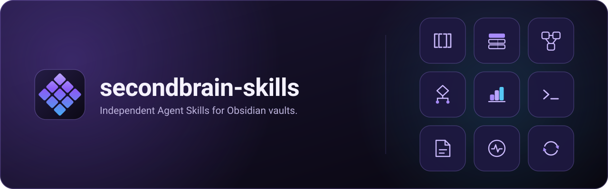

<p align="center">
  
</p>

<p align="center">
  <a href="README.md">English</a> · <b>한국어</b>
</p>

# secondbrain-skills

에이전트가 Obsidian 볼트를 세컨드 브레인으로 운영하게 해 주는 Agent Skill 모음입니다. 자료를 모으고, 원문을 보존하고, 위키로 엮고, 출처를 달아 답합니다.

패키지 하나는 한 가지 일을 맡는 `SKILL.md` 하나입니다. 루트 스킬도, 디스패처도, 공유 런타임도 없습니다. 에이전트는 그 작업에 필요한 패키지만 불러옵니다.

```sh
claude plugin marketplace add GoBeromsu/secondbrain-skills
claude plugin install secondbrain-skills@secondbrain-skills
```

그다음에는 평소 말로 시키면 됩니다. *"이 글 ingest 해줘."*

## 동작 방식

<p align="center">
  
</p>

<p align="center"><sub>이 저장소를 위해 그린 합성 예시이며 스크린샷이 아닙니다.</sub></p>

- **판단은 스킬이 맡습니다.** 무엇을 고르고, 어떻게 분류하고, 언제 멈출지는 Markdown에 적습니다. 스크립트는 질문 하나에만 답하고 실행을 막지 않습니다.
- **원문은 남습니다.** 자료에 대해 무엇을 쓰기 전에 먼저 Raw 노트로 원문 그대로 보존합니다.
- **형식을 안다고 써도 되는 것은 아닙니다.** 패키지는 작업이 허락한 정확한 위치에만 쓰고, 쓴 결과를 다시 읽습니다.
- **증거가 없으면 성공이 아닙니다.** 파싱은 렌더링이 아니고, 종료 코드는 쓰기의 증거가 아닙니다. 패키지는 어느 수준까지 확인했는지 밝힙니다.

## 패키지

목록은 `skills/` 폴더입니다. 폴더 하나가 패키지 하나이고, 각 `SKILL.md`의 description이 맡는 일과 불리는 때를 말합니다.

## 설치

각 런타임의 공식 플러그인·스킬 레지스트리로 설치하고, 업데이트도 같은 경로로 합니다. 이 저장소는 설치 스크립트를 제공하지 않습니다. 플러그인과 함께 스킬 디렉터리에 복사본을 두면 복사본이 플러그인을 가립니다.

| 런타임 | 설치 | 업데이트 |
| --- | --- | --- |
| Claude Code | `claude plugin marketplace add GoBeromsu/secondbrain-skills` 후 `claude plugin install secondbrain-skills@secondbrain-skills` | `claude plugin marketplace update secondbrain-skills` 후 `claude plugin update secondbrain-skills@secondbrain-skills` |
| Codex | `codex plugin marketplace add GoBeromsu/secondbrain-skills` 후 `codex plugin add secondbrain-skills@secondbrain-skills` | `codex plugin marketplace upgrade secondbrain-skills` 후 `codex plugin add secondbrain-skills@secondbrain-skills` |
| GJC | `gjc plugin marketplace add GoBeromsu/secondbrain-skills` 후 `gjc plugin install secondbrain-skills@secondbrain-skills` | `gjc plugin marketplace update secondbrain-skills` 후 `gjc plugin upgrade secondbrain-skills@secondbrain-skills` |
| Grok Build | `grok plugin marketplace add GoBeromsu/secondbrain-skills` 후 Marketplace 탭에서 설치 | Marketplace 탭 |
| Hermes | `hermes plugins install GoBeromsu/secondbrain-skills --enable` (portable 플러그인, 스킬은 `<namespace>:<name>`) | `plugins.auto_apply: true`면 자동 |

플러그인 레지스트리가 없는 런타임(Cursor, 일반 Agent Skills)은 스킬 디렉터리의 `skills/<name>/` 폴더를 읽습니다. 그 런타임이 문서화한 가져오기 방법을 쓰십시오.

## 검증된 것

그 릴리스의 Obsidian 패키지 아홉 개는 Claude Code와 Hermes에 네이티브로 설치했고, 격리된 Obsidian 1.12.7 프로필에서 실행해 봤습니다. 지식 패키지는 로컬 형식 검사만 통과했고 런타임 로드 기록은 없습니다. Hermes에는 `v0.1.0` 태그를 설치하지 마십시오.

## 저장소 구성

```
skills/<name>/SKILL.md   패키지 하나. 나머지는 모두 옆의 하위 폴더에 둡니다
AGENTS.md                기여자와 에이전트를 위한 저장소 계약
```

## 감사의 말

- **[구요한 (Yohan Koo)](https://github.com/johnfkoo951/cmds-llm-wiki)**, cmds-llm-wiki. 지식 패키지는 그의 명령에서 출발했고, 지금은 이 저장소가 정본이며 소유자의 결정에 따라 달라진 부분이 있습니다. 원 저장소의 파일은 하나도 담지 않았습니다. Paper Mode P-7 검증기 `skills/ingest/scripts/verify_paper.py`는 그의 스크립트 없이 이 저장소가 직접 구현한 것입니다. 원 저장소는 라이선스를 공개하지 않았고, 여기서 그것을 재라이선스하지 않습니다.
- **[Andrej Karpathy](https://github.com/karpathy)**, cmds-llm-wiki가 바탕으로 삼은 LLM Wiki 패턴.
- **[Steph Ango (kepano)](https://github.com/kepano/obsidian-skills)**, obsidian-skills (MIT). `markdown`, `bases`, `obsidian-cli`, 그리고 `visualize`의 JSON Canvas 레퍼런스는 여기서 출발해 수정했습니다.
- **[Jonghak Seo](https://github.com/Jonghakseo/pi-extension)**, pi-extension (MIT). `visualize`의 검사 린트와 팔레트·간격 지침은 여기서 가져와 고쳤습니다.
- **[Obsidian](https://github.com/obsidianmd/pele)**, Pele (MIT). `visualize`의 Pele 분기는 공개된 호환성·보안 문서를 따릅니다. Pele 파일은 하나도 싣지 않습니다.
- **[구요한 (Yohan Koo)](https://pele.cmdspace.work/)**, CMDSPACE Pele 갤러리. `visualize` Pele 카탈로그의 쓸 때·피할 때·크기 한도와 관찰된 함정은 이 갤러리를 참고했고, 예제는 모두 이 저장소가 직접 썼습니다.
- **[coleam00](https://github.com/coleam00/excalidraw-diagram-skill)**, excalidraw-diagram-skill. 라이선스 파일이 없습니다. 그 아이디어를 Excalidraw 디자인 지침에 다시 표현했고, 복사한 것은 없습니다.
- **[Zsolt Viczian](https://github.com/zsviczian/obsidian-excalidraw-plugin)**, Obsidian용 Excalidraw 플러그인 (AGPL-3.0)과 동반 플러그인 Excalidraw Extras(라이선스는 확인하지 못했습니다). API 사실을 확인하는 용도로만 읽었고, 코드와 문장은 복사하지 않았습니다.
- **[Excalidraw](https://github.com/excalidraw/excalidraw-libraries)**와 excalidraw-libraries (MIT). 디자인 아이디어를 참고하는 데만 썼습니다.
- **[robtaylor](https://robtaylor.github.io/excalidraw-diagrams/)**, Excalidraw 예제 모음. 아이디어를 참고했습니다. 라이선스를 주장하거나 확인하지 않았고, 복사한 것은 없습니다.

이들의 보증이나 제휴 관계를 주장하지 않습니다. "Obsidian"은 이 스킬들이 대상으로 하는 서드파티 애플리케이션의 이름입니다.

## 라이선스

MIT. [LICENSE](LICENSE)를 참고하십시오. 원 저작물의 허가 고지는 [NOTICE](NOTICE)에 있습니다. `assets/`의 그림은 직접 제작한 원본이며 [assets/asset-ledger.json](assets/asset-ledger.json)에 기록되어 있습니다.
