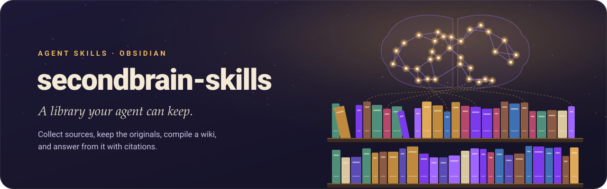
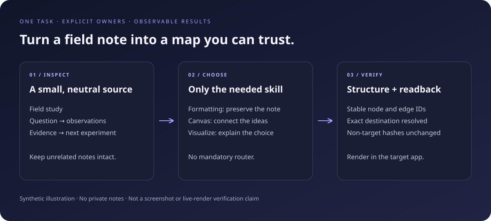

<p align="center">
  
</p>

<p align="center">
  <a href="https://github.com/GoBeromsu/secondbrain-skills/actions/workflows/validate.yml"></a>
  <a href="https://github.com/GoBeromsu/secondbrain-skills/releases"></a>
  <a href="LICENSE"></a>
  <a href="https://agentskills.io"></a>
  <a href="CODE_OF_CONDUCT.md"></a>
</p>

<p align="center">
  <b>English</b> · <a href="README.ko.md">한국어</a>
  <br>
  <a href="#quick-start">Quick start</a> · <a href="#how-it-works">How it works</a> · <a href="#packages">Packages</a> · <a href="#install">Install</a> · <a href="#contributing">Contributing</a> · <a href="#acknowledgements">Acknowledgements</a>
</p>

**secondbrain-skills** lets an agent run an Obsidian vault the way a librarian runs a library. Sources come in through the book drop, the original goes into the archive untouched, a catalogue of wiki pages is compiled from it, and questions are answered in the reading room with citations back to the shelf.

Each package is one `SKILL.md` that owns one job. There is no root skill, no dispatcher and no shared runtime: your agent loads the package the task needs and nothing else.

## Quick start

```sh
claude plugin marketplace add GoBeromsu/secondbrain-skills
claude plugin install secondbrain-skills@secondbrain-skills
```

Then ask in plain language:

> *"Capture these tabs."* · *"Ingest this article."* · *"What does my vault say about spaced repetition?"* · *"Lint the AI folder."*

Other runtimes are under [Install](#install).

## How it works

<p align="center">
  
</p>

| Principle | What it means in practice |
| --- | --- |
| **The skill carries the judgment.** | What to select, how to classify and when to stop are written in Markdown. Scripts answer a single question and never gate a run. |
| **The original survives.** | A source is preserved verbatim as a Raw note before anything is written about it. |
| **Knowing a format is not permission.** | A package writes only to an exact destination the task authorized, then reads the result back. |
| **Missing evidence is never success.** | A parse is not a render, and an exit code is not a write. Each package says which level it reached. |

## Packages

Twenty independent packages. Every row links to the `SKILL.md` that defines it; its `description` is what an agent matches on.

| Shelf | Package | Job |
| --- | --- | --- |
| **Collect** | [`capture`](skills/capture/SKILL.md) | Save tabs, URLs, files, conversations or agent sessions as Inbox candidates. |
| | [`inbox`](skills/inbox/SKILL.md) | Review the Inbox and route a selected scope through `ingest`. |
| **Compile** | [`ingest`](skills/ingest/SKILL.md) | Turn one source into a preserved Raw note plus Wiki pages, Entities and Maps. |
| | [`onboard`](skills/onboard/SKILL.md) | Set up a fresh vault through an owner interview, or diagnose an existing one. |
| | [`refresh-context`](skills/refresh-context/SKILL.md) | Refresh the Core Context snapshot the agent keeps about the owner. |
| | [`reindex`](skills/reindex/SKILL.md) | Refresh the qmd search index after notes change. |
| **Ask** | [`query`](skills/query/SKILL.md) | Answer from the Wiki with citations, and feed gaps back into it. |
| **Shelf care** | [`lint`](skills/lint/SKILL.md) | Mechanical health: links, placement, frontmatter, index and log sync. |
| | [`audit`](skills/audit/SKILL.md) | Sample Wiki pages per Map cluster and score their quality, read-only. |
| | [`verify`](skills/verify/SKILL.md) | Check one page's claims against its cited evidence. |
| | [`status`](skills/status/SKILL.md) | A read-only snapshot of counts, backlog and coverage. |
| **Principles** | [`principle-archival`](skills/principle-archival/SKILL.md) | Provenance, original order and describing a collection as a whole. |
| | [`principle-formatting`](skills/principle-formatting/SKILL.md) | How Markdown is written in an Obsidian vault. |
| | [`principle-knowledge-notes`](skills/principle-knowledge-notes/SKILL.md) | Which kind of note something is (Term, Concept, Guide, Entity) and its template. |
| | [`principle-writing`](skills/principle-writing/SKILL.md) | How prose is drafted, summarized, translated and reviewed. |
| **Obsidian** | [`bases`](skills/bases/SKILL.md) | Obsidian Bases: `.base` files and embedded base blocks. |
| | [`obsidian-cli`](skills/obsidian-cli/SKILL.md) | Drive the running desktop app through the official `obsidian` CLI. |
| | [`obsidian-clipper`](skills/obsidian-clipper/SKILL.md) | Author and repair Web Clipper template JSON. |
| | [`obsidian-sync`](skills/obsidian-sync/SKILL.md) | Headless Obsidian Sync with the `ob` client. |
| | [`obsidian-visualize`](skills/obsidian-visualize/SKILL.md) | JSON Canvas, Excalidraw and Pele mermaid visuals. |

## Install

Install through each runtime's own plugin or skill registry, and update the same way. This repository ships no installer script, and a directory copy next to a plugin install shadows the plugin.

<details open>
<summary><b>Claude Code</b></summary>

```sh
claude plugin marketplace add GoBeromsu/secondbrain-skills
claude plugin install secondbrain-skills@secondbrain-skills
# update
claude plugin marketplace update secondbrain-skills
claude plugin update secondbrain-skills@secondbrain-skills
```
</details>

<details>
<summary><b>Codex</b></summary>

```sh
codex plugin marketplace add GoBeromsu/secondbrain-skills
codex plugin add secondbrain-skills@secondbrain-skills
# update
codex plugin marketplace upgrade secondbrain-skills
codex plugin add secondbrain-skills@secondbrain-skills
```
</details>

<details>
<summary><b>GJC</b></summary>

```sh
gjc plugin marketplace add GoBeromsu/secondbrain-skills
gjc plugin install secondbrain-skills@secondbrain-skills
# update
gjc plugin marketplace update secondbrain-skills
gjc plugin upgrade secondbrain-skills@secondbrain-skills
```
</details>

<details>
<summary><b>Grok Build</b></summary>

```sh
grok plugin marketplace add GoBeromsu/secondbrain-skills
```

Then install and update from the Marketplace tab.
</details>

<details>
<summary><b>Hermes</b></summary>

```sh
hermes plugins install GoBeromsu/secondbrain-skills --enable
```

A portable plugin; skills resolve as `<namespace>:<name>` and update automatically with `plugins.auto_apply: true`. Do not install the `v0.1.0` tag on Hermes.
</details>

<details>
<summary><b>Other runtimes</b> (Cursor, generic Agent Skills, Aside)</summary>

Runtimes without a plugin registry read `skills/<name>/` folders from their skill directory; use their own documented import. Aside reads `<account root>/skills/user/<name>/SKILL.md`.
</details>

## What is verified

Every push and pull request runs [`validate`](.github/workflows/validate.yml) in CI:

| Check | Tool |
| --- | --- |
| Plugin format | `claude plugin validate . --strict` |
| Manifests parse, share one name and one version | [`scripts/validate.py`](scripts/validate.py) |
| Each `skills/<name>/SKILL.md` has frontmatter whose `name` is its folder and a description within 1,024 characters | `scripts/validate.py` |
| Every package is listed in both READMEs, and every relative link resolves | `scripts/validate.py` |
| Every image is recorded in the [asset ledger](assets/asset-ledger.json); SVGs carry no scripts or external references; the icon is a square PNG | `scripts/validate.py` |
| Bundled scripts compile, and `link-lint.py` reproduces its [eval](evals/lint-links) | `scripts/validate.py` |

Run the same checks locally with `python3 scripts/validate.py`. These are static checks: they claim no runtime load. What a change was run against is named in that change's commit message.

Releases: `scripts/release.sh <version>` on `main` sets the version in every manifest (skills carry none), runs the validator, tags, pushes and publishes the prerelease.

## Contributing

Issues and pull requests are welcome. Keep one job per package, keep judgment in Markdown rather than scripts, and run `python3 scripts/validate.py` before you push.

Everyone taking part is expected to follow the [Code of Conduct](CODE_OF_CONDUCT.md) (Contributor Covenant 2.1).

## Acknowledgements

This library stands on other people's shelves. Nothing below implies endorsement; full upstream notices are in [NOTICE](NOTICE).

| Source | Used in | How |
| --- | --- | --- |
| [Steph Ango (kepano), obsidian-skills](https://github.com/kepano/obsidian-skills) · MIT | `principle-formatting`, `bases`, `obsidian-cli`, JSON Canvas reference in `obsidian-visualize` | Started from it and modified |
| [Yohan Koo (구요한), cmds-llm-wiki](https://github.com/johnfkoo951/cmds-llm-wiki) · no licence published | the knowledge packages | Started from its commands; this repository is now their canonical source and diverges where the owner decided. No upstream file is shipped and nothing is relicensed |
| [Andrej Karpathy](https://github.com/karpathy) | the knowledge packages | The LLM Wiki pattern that cmds-llm-wiki builds on |
| [기록학 16주 완성](https://wikidocs.net/25577), ICA *ISAD(G)* 2nd ed. (2000), T. R. Schellenberg *Modern Archives* (1956) | `principle-archival` | An original English application, not a reproduction |
| [Jonghak Seo, pi-extension](https://github.com/Jonghakseo/pi-extension) · MIT | `obsidian-visualize` | Inspection lint, palette and spacing guidance adapted |
| [Obsidian, Pele](https://github.com/obsidianmd/pele) · MIT | `obsidian-visualize` | The Pele branch follows its public compatibility and security docs; no Pele file is shipped |
| [Yohan Koo (구요한), CMDSPACE Pele gallery](https://pele.cmdspace.work/) | `obsidian-visualize` | Use, avoid and size guidance and observed pitfalls consulted; every example is this repository's own |
| [coleam00, excalidraw-diagram-skill](https://github.com/coleam00/excalidraw-diagram-skill) · no licence file | `obsidian-visualize` | Ideas re-expressed in the Excalidraw design guidance; nothing copied |
| [Zsolt Viczian, Excalidraw plugin](https://github.com/zsviczian/obsidian-excalidraw-plugin) · AGPL-3.0, and Excalidraw Extras · licence not verified | `obsidian-visualize` | Read for API facts only; no code or prose copied |
| [Excalidraw, excalidraw-libraries](https://github.com/excalidraw/excalidraw-libraries) · MIT | `obsidian-visualize` | Design ideas only |
| [robtaylor, Excalidraw example gallery](https://robtaylor.github.io/excalidraw-diagrams/) · licence not verified | `obsidian-visualize` | Ideas only; nothing copied |
| [Anthropic, skill-creator](https://github.com/anthropics/skills/tree/main/skills/skill-creator) and the [Claude Fable 5.2 prompting guide](https://platform.claude.com/docs/en/build-with-claude/prompt-engineering/prompting-claude-fable-5-2) | `obsidian-visualize`, `principle-archival`, `principle-formatting`, `principle-writing` | How source-image, link and text-budget guidance is worded; nothing copied |
| [GMU Writing Center](https://writingcenter.gmu.edu/writing-resources/general-writing-practices/cohesion-and-coherence), [Purdue OWL](https://owl.purdue.edu/owl/subject_specific_writing/professional_technical_writing/audience_analysis/index.html), [Manchester Academic Phrasebank](https://www.phrasebank.manchester.ac.uk/using-cautious-language/), Google [Technical Writing One](https://developers.google.com/tech-writing/one/words) and [developer style guide](https://developers.google.com/style/lists) | `principle-writing` | Consulted; every line is this repository's own |

"Obsidian" names the third-party application these skills target; no affiliation is claimed.

## License

[MIT](LICENSE). Upstream grants are reproduced in [NOTICE](NOTICE). All art in `assets/` is original work recorded in the [asset ledger](assets/asset-ledger.json); none of it is a screenshot.
