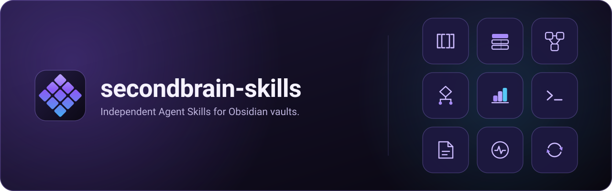

<p align="center">
  
</p>

<p align="center">
  <b>English</b> · <a href="README.ko.md">한국어</a>
</p>

# secondbrain-skills

Agent Skills that let an agent run an Obsidian vault as a second brain: collect a source, keep the original, compile it into a wiki, and answer from it with citations.

Each package is one `SKILL.md` that owns one job. There is no root skill, no dispatcher and no shared runtime. Your agent loads the package the task needs and nothing else.

```sh
claude plugin marketplace add GoBeromsu/secondbrain-skills
claude plugin install secondbrain-skills@secondbrain-skills
```

Then ask in plain language: *"Ingest this article."*

## How it works

<p align="center">
  
</p>

<p align="center"><sub>Synthetic illustration drawn for this repository. It is not a screenshot.</sub></p>

- **The skill carries the judgment.** What to select, how to classify and when to stop are written in Markdown. Scripts answer a single question and never gate a run.
- **The original survives.** A source is preserved verbatim as a Raw note before anything is written about it.
- **Knowing a format is not permission.** A package writes only to an exact destination the task authorized, then reads the result back.
- **Missing evidence is never success.** A parse is not a render, and an exit code is not a write. Each package says which level it reached.

## Packages

`skills/` is the list: one folder per package, and each `SKILL.md` description says what the package owns and when it triggers.

## Install

Install through each runtime's own plugin or skill registry, and update the same way. This repository ships no installer script, and a directory copy next to a plugin install shadows the plugin.

| Runtime | Install | Update |
| --- | --- | --- |
| Claude Code | `claude plugin marketplace add GoBeromsu/secondbrain-skills`, then `claude plugin install secondbrain-skills@secondbrain-skills` | `claude plugin marketplace update secondbrain-skills`, then `claude plugin update secondbrain-skills@secondbrain-skills` |
| Codex | `codex plugin marketplace add GoBeromsu/secondbrain-skills`, then `codex plugin add secondbrain-skills@secondbrain-skills` | `codex plugin marketplace upgrade secondbrain-skills`, then `codex plugin add secondbrain-skills@secondbrain-skills` |
| GJC | `gjc plugin marketplace add GoBeromsu/secondbrain-skills`, then `gjc plugin install secondbrain-skills@secondbrain-skills` | `gjc plugin marketplace update secondbrain-skills`, then `gjc plugin upgrade secondbrain-skills@secondbrain-skills` |
| Grok Build | `grok plugin marketplace add GoBeromsu/secondbrain-skills`, then install from the Marketplace tab | the Marketplace tab |
| Hermes | `hermes plugins install GoBeromsu/secondbrain-skills --enable` (portable plugin; skills resolve as `<namespace>:<name>`) | automatic with `plugins.auto_apply: true` |

Runtimes without a plugin registry (Cursor, generic Agent Skills) read `skills/<name>/` folders from their skill directory; use their own documented import.

Release: `scripts/release.sh <version>` on `main` sets that version in the four plugin manifests (skills carry none), tags, pushes and publishes the prerelease.

## What is verified

The nine Obsidian packages of that release were installed natively on Claude Code and on Hermes, and exercised against an isolated Obsidian 1.12.7 profile. The knowledge packages pass the local format checks only; no runtime load of them is recorded. Do not install the `v0.1.0` tag on Hermes.

## Repository layout

```
skills/<name>/SKILL.md   one package; everything else sits in a subfolder beside it
AGENTS.md                repository contract for contributors and agents
```

## Acknowledgements

- **[Yohan Koo (구요한)](https://github.com/johnfkoo951/cmds-llm-wiki)**, cmds-llm-wiki. The knowledge packages started from its commands; this repository is now their canonical source and diverges where the owner decided. No upstream file is shipped: the Paper Mode P-7 verifier `skills/ingest/scripts/verify_paper.py` is this repository's own implementation, written without his script. The upstream publishes no licence and nothing here relicenses it.
- **[Andrej Karpathy](https://github.com/karpathy)**, the LLM Wiki pattern that cmds-llm-wiki builds on.
- **[Steph Ango (kepano)](https://github.com/kepano/obsidian-skills)**, obsidian-skills (MIT). `markdown`, `bases`, `obsidian-cli` and the JSON Canvas reference in `visualize` started from it and were modified.
- **[Jonghak Seo](https://github.com/Jonghakseo/pi-extension)**, pi-extension (MIT). The inspection lint and the palette and spacing guidance in `visualize` are adapted from it.
- **[Obsidian](https://github.com/obsidianmd/pele)**, Pele (MIT). The Pele branch of `visualize` follows its public compatibility and security documentation; no Pele file is shipped.
- **[Yohan Koo (구요한)](https://pele.cmdspace.work/)**, the CMDSPACE Pele gallery. The use, avoid and size guidance and the observed pitfalls in the `visualize` Pele catalog were consulted from it; every example there is this repository's own.
- **[coleam00](https://github.com/coleam00/excalidraw-diagram-skill)**, excalidraw-diagram-skill. It has no licence file; its ideas informed the Excalidraw design guidance and are re-expressed, nothing is copied.
- **[Zsolt Viczian](https://github.com/zsviczian/obsidian-excalidraw-plugin)**, the Excalidraw plugin for Obsidian (AGPL-3.0), and the Excalidraw Extras companion plugin, whose licence was not verified. Read for API facts only; no code or prose is copied.
- **[Excalidraw](https://github.com/excalidraw/excalidraw-libraries)** and its excalidraw-libraries (MIT). Consulted for design ideas only.
- **[robtaylor](https://robtaylor.github.io/excalidraw-diagrams/)**, an Excalidraw example gallery, consulted for ideas. No licence is claimed or verified; nothing is copied.

No endorsement by any of them is claimed. "Obsidian" names the third-party application these skills target.

## License

MIT. See [LICENSE](LICENSE); upstream grants are reproduced in [NOTICE](NOTICE). Art in `assets/` is original work recorded in [assets/asset-ledger.json](assets/asset-ledger.json).
