# Diagram catalog

Pick the family from the meaning, then write the grammar. For common Mermaid families only the Pele-specific deltas are listed; for families that are new, beta or Pele-only, a minimal verified block follows. Replace labels and data; leave the grammar alone.

**Status:** the blocks are cut down from blocks that, like every *observed* pitfall, were rendered through `window.pele.render()` in Obsidian 1.15.1 (installer 1.15.0), level C. None is verified in your target note until it is opened there (level D).

## Choosing the family

"Keep under" is the size past which the diagram stops being readable; split at a real boundary (phase, actor, subsystem) instead of growing it.

| Meaning to carry | Keyword | Avoid when | Keep under |
| --- | --- | --- | --- |
| Ordered steps with branches (default, and the structural fallback) | `flowchart LR`/`TD` | 3+ actors hand off (swimlane); messages in time order (sequence) | 15 nodes |
| Who sends what to whom, in order | `sequenceDiagram` | > 6 participants or 15 messages | 5 participants, 12 messages |
| Types, members, cardinality | `classDiagram` | readers are not developers | 6 classes |
| Lifecycle of one thing; UI statechart | `stateDiagram-v2` | content is actions, not states | 8 states |
| Stored entities and keys | `erDiagram` | long attribute lists (table) | 6 entities |
| Dated work with durations | `gantt` | only order, no dates | 10 tasks, 4 sections |
| Experience scored 1–5 per step | `journey` | no measured score | 10 steps |
| Parts of one whole | `pie` | > 7 slices or close values (xychart) | 6 slices |
| Branching outline of one topic | `mindmap` | cross-branch relations matter | 9 branches, 25 nodes |
| Dated milestones in order | `timeline` | period length matters (gantt) | 8 periods |
| Quantified flow between stages | `sankey-beta` | stages have no values | 12 nodes |
| Work items by workflow column | `kanban` | dates are the point | 4 columns, 12 cards |
| Nested proportions | `treemap-beta` | no hierarchy | 15 leaves |
| Services, groups, links | `architecture-beta` | people and external context matter (C4) | 10 services |
| Numeric series over categories | `xychart-beta` | profile over 3+ criteria (radar) | 12 categories, 3 series |
| Several actors handing off one process | `swimlane-beta` | a single actor | 4 lanes, 12 nodes |
| A page or screen divided into a grid | `block-beta` | flow is the point | 12 blocks |
| Agents splitting work and calling tools | `agentflow-beta` | no tool is called | 10 nodes |
| Versions, branches, merges | `gitGraph` | no branches (timeline) | 3 branches, 12 commits |
| Screens, commands, events over time | `eventmodeling` | outside design docs | 8 timeframes |
| A few subjects profiled on several criteria | `radar-beta` | 1–2 criteria | 8 axes, 4 curves |
| Items placed on two criteria | `quadrantChart` | positions are unevidenced impressions | 12 points |
| Overlap of 2–3 sets | `venn-beta` | 4+ sets | 3 sets |
| Requirements traced to what satisfies them | `requirementDiagram` | presentations | 5 requirements |
| People, systems, external systems | `C4Context` | component layout is the point | 8 elements |
| What actors want from a system | `usecase-beta` | a feature list (table) | 8 use cases |
| Fixed-width fields of an identifier | `packet-beta` | variable-length fields (railroad) | 12 fields |
| A notation rule as EBNF | `railroad-ebnf-beta` | a one-line rule | 6 rules |
| Folder and file paths | `treeView-beta` | the hierarchy carries sizes (treemap) | 20 lines |
| Causes of one problem by category | `ishikawa-beta` | causes depend on each other | 15 causes |
| Work sorted into Cynefin domains | `cynefin-beta` | no evidence for placement | 3 items per domain |
| Value chain by visibility and evolution | `wardley-beta` | coordinates presented as data | 10 components |

Quadrant, wardley and cynefin placements are judgements: say so in the title or caption.

## Common families: Pele deltas

- **flowchart** — Below about 640 px Pele may draw `LR` top-to-bottom; write it to read both ways. Two subgraphs with no edge between them stack vertically even under `LR`. Lowercase `end` as a node breaks the parser. `classDef`/`:::`, `style` and `linkStyle N` (0-based, source order) work. `<code>`/`<kbd>` lose the tag; write `<`/`>` as `#lt;`/`#gt;`.
- **sequenceDiagram** — Declare participants for a deliberate column order. A participant alias has no quoted form: `participant C as "CI(build/test)"` prints the quotes; write `participant C as CI(build/test)` bare. Nest `alt`/`loop`/`opt` at most two deep.
- **stateDiagram-v2** — The `-v2` suffix is part of the keyword. For a UI statechart label each edge `event / effect`; to propose a change, draw current and proposed as two fences with the same state names.
- **erDiagram** — Pele gathers every relation marker leaving one entity at its bottom centre and keeps the diagram about 770 px wide.
- **gantt** — Task states precede the id: `done`, `active`, `crit`, `milestone` (with `0d`).
- **pie** — Quote every slice label (`"Print" : 62`); an unquoted one is a *Lexical error*. Do **not** quote the title: `pie title "Loans"` prints the quotes; write `pie title Loans`. Slices under 1% lose their percentage label.
- **mindmap** — Indentation is the grammar; never mix tabs and spaces. `classDef` fails with *There can be only one root* (*observed*). A first-level node with no children draws as bare text without a box; give it a child or an explicit shape.
- **timeline** — Section headers use the background colour as text colour; check legibility in the vault theme.
- **sankey-beta** — CSV rows `source,target,value`; quote a value containing a comma. Probe non-ASCII node names on the target app first (older bundled Pele rejected Hangul). Don't put totals in node names; Pele appends values itself.
- **quadrantChart** — Do not quote `title` (Pele draws the quotes). Minimum width about 280 px.
- **C4Context** — Move colliding relation labels with `UpdateRelStyle(from, to, $offsetX="-40", $offsetY="-20")`.
- **gitGraph** — Case-exact: `gitgraph` fails with *No diagram type detected* (*observed*). With a merge, turn off the 45-degree labels that cover the curve:

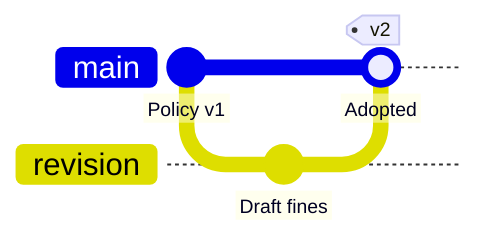

## New, beta and Pele-only families

### kanban

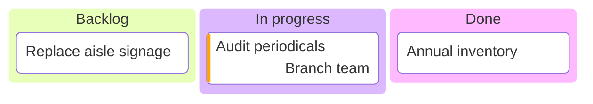

Metadata keys: `assigned`, `ticket`, `priority`; `priority` accepts only `Very High`, `High`, `Low`, `Very Low`.

### treemap-beta

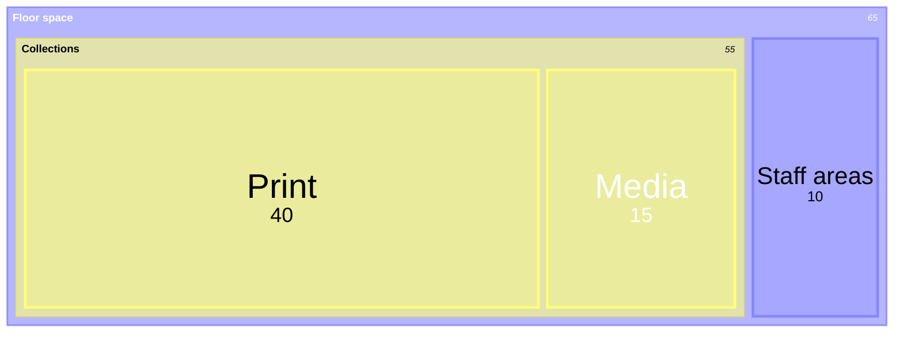

Names quoted, indentation is hierarchy, `: value` on leaves only. Narrow widths draw small groups as empty boxes.

### architecture-beta

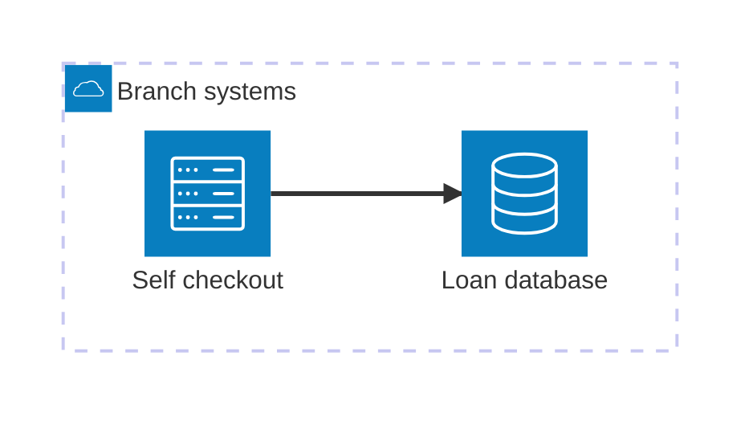

Ids are bare keys, never quoted; labels in `[]`, icons in `()`. Built-in icons: `cloud`, `database`, `disk`, `internet`, `server`. Declaration order sets layout; reorder if an edge runs through a service.

### xychart

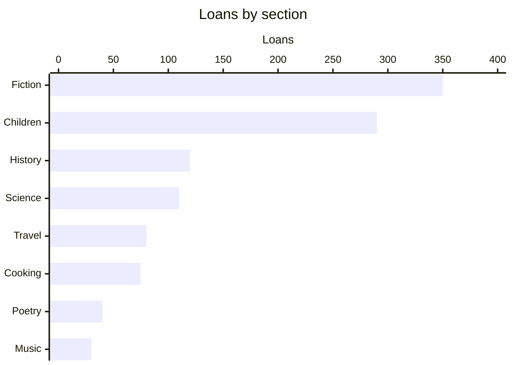

`xychart` or `xychart-beta`; `horizontal` is Pele-only. Use it past seven categories or with long names: vertical bars silently drop labels that don't fit. Every series must match the category count; start the y-axis at 0.

### swimlane-beta

```mermaid
swimlane-beta LR
  subgraph reader["Reader"]
    ask["Request title"]
    pick["Pick up"]
  end
  subgraph desk["Desk staff"]
    check["Check catalog"]
  end
  ask --> check
  check -->|"on shelf"| pick
```

One subgraph is one lane, named for a person or role. Quote labels and edge labels containing `(`. About 580 px wide regardless of note width.

### block-beta

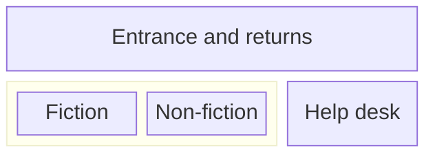

`columns N` sets the grid, `id:span` the width; `block:ID:span … end` nests.

### agentflow-beta

```mermaid
agentflow-beta TB
  connector llm["Language model"]
  llm@{ protocol: "http", endpoint: "/v1/chat" }
  flow intake["Intake agent"]
    q["Reader question"]@{ shape: input }
    plan["Split into lookups"]@{ shape: task }
    q --> plan
  end
  flow lookup["Catalog agent"]
    search["Search catalog"]@{ shape: tool, connectorRef: "llm.run", returns: "Records" }
    rules["Lending policy"]@{ shape: refdoc }
    search -.- rules
  end
  plan --> search
```

Shapes: `input`, `task`, `tool`, `action`, `refdoc`. A connector is drawn apart, not joined by an edge.

### eventmodeling

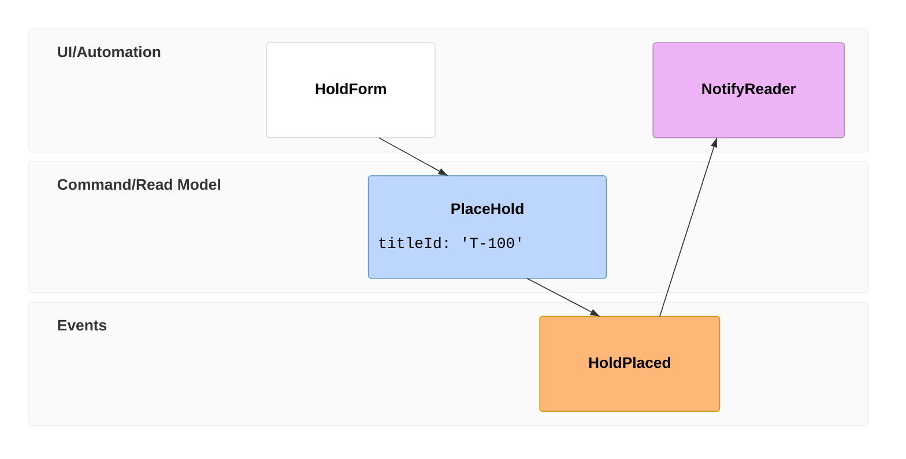

### radar-beta

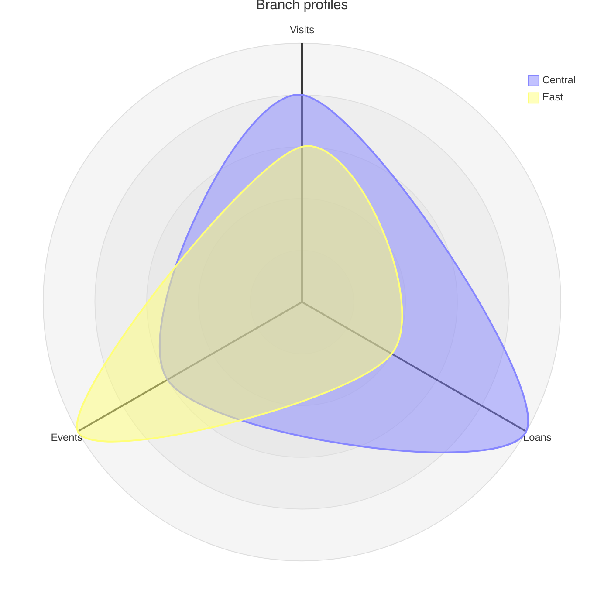

State `max` and `min` explicitly.

### venn-beta

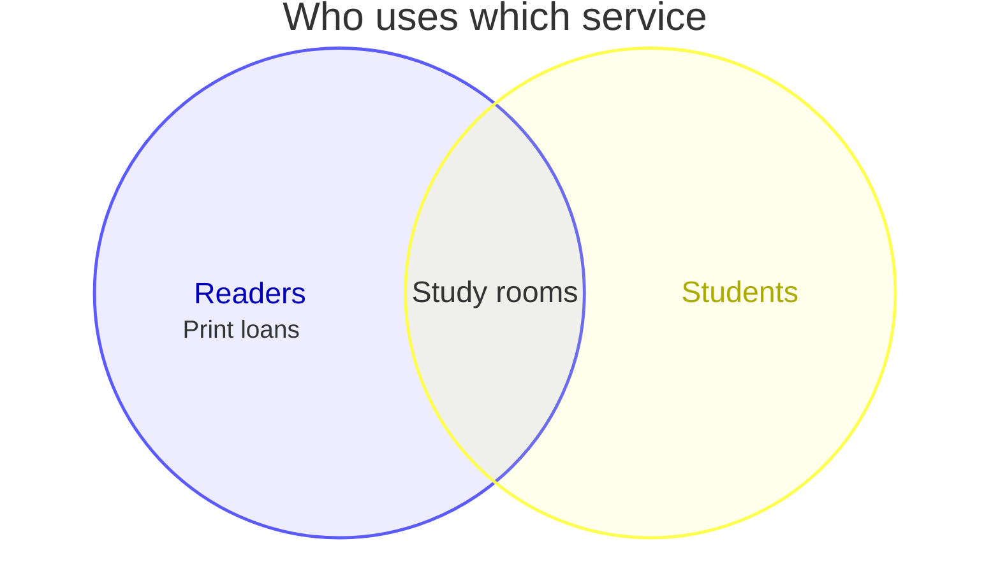

`union` names an intersection, `text` an item in one set. Short intersection labels; long ones spill.

### requirementDiagram

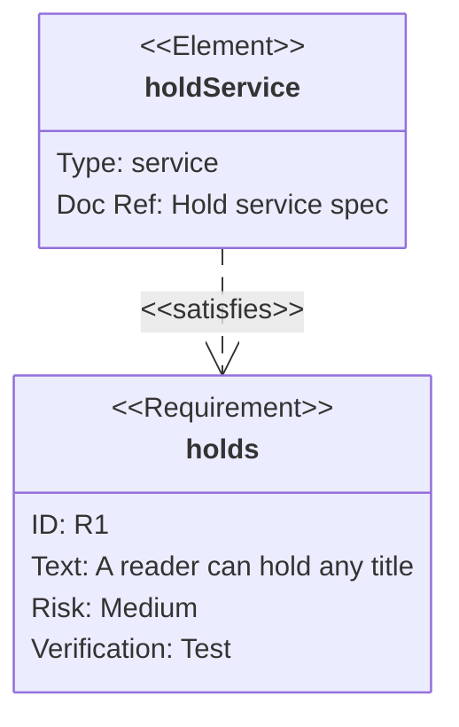

Quote `text` and `docref`; unquoted non-ASCII fails with *Lexical error* (*observed*). `test` is valid as a `verifymethod`, a parse error as an element `type`.

### usecase-beta

```mermaid
usecase-beta
direction LR
actor Reader("Reader")
systemBoundary Catalog
  Search("Search titles")
  Hold("Place hold")
end
Reader --> Search
Hold ..> : include Search
```

Ids must be ASCII; put the display name in quoted parentheses, `actor Reader("도서관 이용자")` (*observed*).

### packet-beta

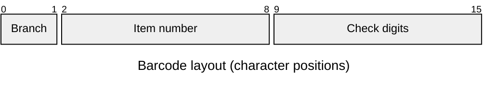

When cells are characters, not bits, say so in the title.

### railroad-ebnf-beta

```mermaid
railroad-ebnf-beta
title "Shelf mark"

shelfmark = section "." number [ "/" volume ] ;
section = "FIC" | "HIS" ;
number = digit { digit } ;
volume = digit { digit } ;
digit = "0" | "1" | "2" ;
```

Optional parts as `[ … ]`; two `?` in one rule read as a special sequence `? … ?`.

### treeView-beta

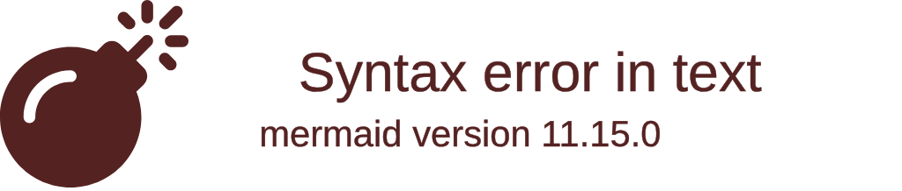

Folders end with `/`; `##` starts a comment. An entry starting with `title` is read as the diagram title and fails (*observed*).

### ishikawa-beta

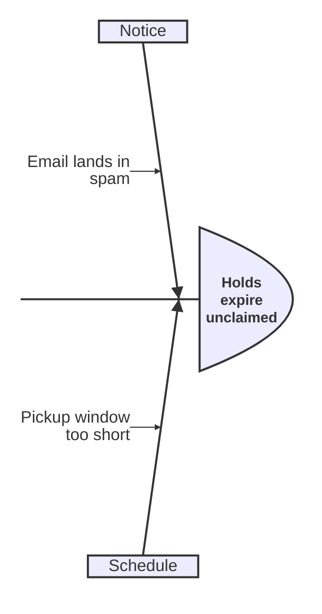

First line the problem, one indent a category, two a cause.

### cynefin-beta

```mermaid
cynefin-beta
  title Where branch work sits
  clear
    "Shelving returns"
  complex
    "Community programs"
  chaotic
    "Flooded basement"
  chaotic --> complex : "Stabilize"
```

Items and transition labels are quoted strings.

### wardley-beta

```mermaid
wardley-beta
title Reader service value chain

anchor "Reader" [0.95, 0.70]
component "Holds" [0.80, 0.55]
component "Search index" [0.40, 0.45]
"Reader" -> "Holds"
"Holds" -> "Search index"
evolve "Search index" 0.70
note "Placement is a judgement" [0.15, 0.30]
```

`[visibility, evolution]`. Quote names; an unquoted name with a dot fails with *Lexical error* (*observed*).
