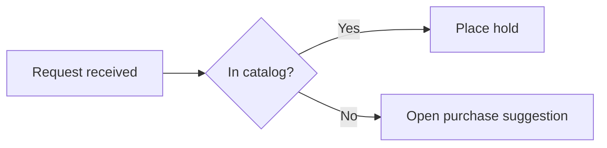

# Pele diagrams

Produce a `mermaid` fence that carries the intended meaning and renders in Pele, the renderer Obsidian 1.15.0 and later ship.

Done means: the diagram family fits the relationship being shown, the prefix and grammar are accepted by Pele, the source sits in an exact `mermaid` fence, unrelated note content is byte-for-byte untouched, and every claim is backed by the evidence level that actually produced it.

## What Pele is

Obsidian 1.15.0 stopped bundling Mermaid. Every `mermaid` fence is drawn by Pele, an MIT-licensed renderer that targets Mermaid 12.1.0 syntax and every diagram type built into it. It uses its own layout and the vault theme's colors and fonts, and runs no code, so there is no setting to enable.

- **Another renderer is not evidence.** mermaid.live and code hosts run real Mermaid, and node positions, spacing and edge paths differ from Pele's. Mermaid themes do not apply and `themeVariables` colors act only as series palettes (pele.run/compatibility); colors and fonts come from the vault theme through `--pele-*` CSS variables (pele.run/theming; the 1.15.0 changelog says `--mermaid-*`). Judge appearance only in the target app.
- **No code runs.** Pele ignores JavaScript callbacks in `click`, blocks `javascript:`, `data:` and `vbscript:` links, escapes text and filters styles. ZenUML and other external Mermaid plugins and arbitrary HTML labels are not supported. Source over 50,000 characters, SVG output over 4,000,000 characters, or a flowchart over 5,000 edges is rejected.
- **The Pele inside the app can lag Pele releases.** Obsidian moves its bundled Pele only when the app updates, so a feature in Pele's release notes is not evidence for the vault. On Obsidian 1.15.0 with installer 1.13.4 `pele.render()` rejected a Hangul sankey node name; on 1.15.1 with installer 1.15.0 it accepts one. Probe a recent feature on the target app first. A synced vault is only as new as its oldest app: probe on each device that renders it, keep the older form if a probe fails, and never quote a version from another machine.
- **Host options are the app's, not the note's:** the narrow-width switch from `LR` to `TB` and sankey gradients and the size limits cannot be set by a note.
- **Keywords.** Write `flowchart` (`graph` is an alias) and `stateDiagram-v2`. `-beta` is optional where Pele accepts both spellings (`sankey`, `treemap`, `xychart`); `architecture-beta` is the only spelling Pele lists. Pele also accepts `C4Container`, `C4Component`, `C4Dynamic`, `C4Deployment`, `railroad-beta`, `railroad-abnf-beta`, `railroad-peg-beta`, and the unsuffixed `block`, `packet` and `ishikawa`.

Pele has no command-line tool and needs no plugin. To confirm a fence without opening the note, call Pele's runtime from `obsidian eval`. `window.pele` is not guaranteed to exist yet and `loadMermaid` is not a global, so load it through the Excalidraw plugin first, then call `window.pele.render(source)`. `render` is synchronous: it returns `{svg}` or throws a `PeleError` carrying the parse error text.

```bash
obsidian vault=<name> eval code='(()=>{const r=window.__check={s:"run"};ExcalidrawAutomate.obsidian.loadMermaid().then(()=>{try{r.n=window.pele.render("flowchart LR\n  A --> B").svg.length;r.s="ok"}catch(e){r.s="fail";r.e=String(e.message)}});return "ok"})()'
obsidian vault=<name> eval code='JSON.stringify(window.__check)'
```

To check every fence of a note, read the file with `app.vault.cachedRead`, take each ```` ```mermaid ```` body and render it the same way. Without the Excalidraw plugin, open the note as a preview tab and count what drew, then close the tab:

```bash
obsidian vault=<name> eval code='(()=>{const f=app.vault.getAbstractFileByPath("<path>");const l=app.workspace.getLeaf("tab");window.__leaf=l;l.openFile(f,{state:{mode:"preview"}}).then(()=>setTimeout(()=>{window.__n=l.view.previewMode.containerEl.querySelectorAll("svg.pele").length},1500));return "ok"})()'
obsidian vault=<name> eval code='window.__n'
obsidian vault=<name> eval code='window.__leaf.detach()'
```

To look at the result, take a screenshot while the preview tab is open and before it is detached, with a path outside the vault, then open the PNG:

```bash
obsidian vault=<name> dev:screenshot path=<absolute-path>.png
```

The screenshot captures the whole app window, so it also shows other tab titles: keep it out of the vault and out of anything shipped. Do not rasterize a saved `pele.render` SVG with `rsvg-convert` or similar: `var(--pele-*)` variables only resolve inside the app and boxes come out black. Flowchart, sequence and pie blocks, including Korean text, were legible in both themes on 1.15.1 (observed); other families were not checked.

Writing a probe note is a vault mutation: it needs the task's own authorization, an agreed location and an agreed cleanup. A scratch vault avoids the question, because the renderer belongs to the app, not the vault. Pele draws in Reading view and in Live Preview (observed on 1.15.1, installer 1.15.0); in Live Preview count `svg.pele` inside `.cm-content`, because counting the whole view container doubles it. Run the `obsidian` CLI directly; do not wrap it in a script.

A block that fails to draw in the preview stays in the page as a box of text beginning with `Parse error` or `Lexical error`, so reading the text of each `.el-pre` element names the failing block. `window.pele.supports("<keyword>")` answers whether a diagram keyword exists without rendering.

## Evidence ladder

The ladder is in [`../SKILL.md`](../SKILL.md). For a Pele block: A is the source read against [`pele-catalog.md`](pele-catalog.md) and the rules here; B is the note's bytes re-read after the write; C is `window.pele.render(source)` accepting the grammar, with the version from `obsidian version` stated (mermaid.live or the Mermaid CLI prove real Mermaid, not Pele); D is the note open in the target Obsidian and looked at.

When a level cannot be reached — no app access, no vault authorization, headless environment — say which level was reached and name the rest as unverified.

## Workflow

1. **State the meaning first.** Write the sentence the diagram must communicate (sequence of steps, message order, state transitions, proportions, hierarchy, flow quantities). The sentence chooses the family.
2. **Pick the smallest family that carries it** using the table below.
3. **Start from the catalog entry**, not from memory. Replace labels and data; leave the grammar alone.
4. **Write labels** under the escaping and readability rules below.
5. **Fence it exactly** (see Fences and placement).
6. **Only if the task actually edits a note:** confirm write authorization for that exact note, make the narrowest possible edit, and read the file back (see Editing a note safely).
7. **Render QA** in the target installation only when asked; level C already proves the grammar and needs no opened note. Record the app and installer versions from `obsidian version`; Pele exposes no version field, so never invent one. Check labels at the note's real width and in dark mode, with nothing clipped or overlapping, and name what was not checked; an error, a raw source dump or a blank area all fail.
8. **On a parse error, fix the source.** If the family cannot carry the meaning, change family without dropping information (see Failing without degrading meaning).

## Choosing the family

| The meaning to carry | Family | Notes |
| --- | --- | --- |
| Ordered steps with branches | `flowchart TD` / `flowchart LR` | The default; also the fallback for any structural diagram |
| Who sends what to whom, in order | `sequenceDiagram` | Name participants explicitly; arrow type encodes sync/async/return |
| Types, fields, and cardinality | `classDiagram` | Use for a domain model, not for runtime steps |
| Lifecycle of one thing | `stateDiagram-v2` | Exact `-v2` suffix |
| Stored entities and their keys | `erDiagram` | Schema shape, not process |
| Dated work with durations | `gantt` | Needs `dateFormat`; durations, not vibes |
| Step-by-step experience with scores | `journey` | Score and actor follow each task label |
| Parts of one whole | `pie` | Quote every label; one level only |
| Branching outline of one topic | `mindmap` | Indentation is the grammar — keep it consistent |
| Dated milestones in order | `timeline` | One period line, then its events |
| Quantified flow between stages | `sankey-beta` | CSV-shaped rows: source, target, value |
| Work items across workflow columns | `kanban` | |
| Nested proportions | `treemap-beta` | |
| Services, groups, and their links | `architecture-beta` | |
| Numeric series over categories | `xychart-beta` | |
| Several actors handing off one process | `swimlane-beta` | |
| A page or screen divided into a grid | `block-beta` | |
| Agents splitting work and calling tools | `agentflow-beta` | |
| Versions, branches and merges | `gitGraph` | Case-exact keyword |
| Screens, commands and events changing state | `eventmodeling` | |
| A few subjects profiled on several criteria | `radar-beta` | |
| Items placed on two criteria | `quadrantChart` | |
| Overlap of two or three sets | `venn-beta` | |
| Requirements traced to what satisfies them | `requirementDiagram` | |
| People, systems and external systems | `C4Context` | |
| What actors want from a system | `usecase-beta` | |
| Fixed-width fields of an identifier | `packet-beta` | |
| A notation rule as EBNF | `railroad-ebnf-beta` | |
| Folder and file paths | `treeView-beta` | |
| Causes of one problem by category | `ishikawa-beta` | |
| Work sorted into Cynefin domains | `cynefin-beta` | |
| Value chain by visibility and evolution | `wardley-beta` | |

Each catalog pattern also names when to avoid its family and the size past which it stops being readable.

Split a diagram at a real boundary (phase, actor, subsystem) as soon as labels overlap or edges cross unreadably. Pele scales wide diagrams down and lets the reader zoom and pan; that is not readability. Two readable diagrams beat one complete unreadable one.

## Syntax pitfalls

Every row failed in Obsidian 1.15.1 (installer 1.15.0) through `window.pele.render()` or a preview tab. Quote every label as a habit: it is cheap, and `(` and `|` fail without it.

| You wrote | Pele says | Fix |
| --- | --- | --- |
| `A[Renewal (second request)]` | `Parse error ... got 'PS'` | `A["Renewal (second request)"]` |
| `A -->\|yes (ok)\| B` | `Parse error ... got 'PS'` | `A -->\|"yes (ok)"\| B` |
| `A[a\|b]` | `Parse error ... got 'PIPE'` | quote the label |
| `participant X as "CI(빌드/테스트)"` | no error: the quotes print literally in the box | sequence has no quoted form: write `participant X as CI(빌드/테스트)` bare |
| `A --> end` | `Parse error ... got 'end'` | `End`, or `[end]`, which draws |
| `subgraph S1` with no `end` | `Parse error ... Expecting 'end'` | close every subgraph |
| `statediagram-v2`, `sequencediagram`, `gitgraph` | `No diagram type detected` | exact case: `stateDiagram-v2`, `sequenceDiagram`, `gitGraph` |
| `zenuml`, a comment-only fence, an empty fence | `No diagram type detected` | ZenUML is unsupported; use `sequenceDiagram` |
| `pie` with `A : 3` | `Lexical error` | quote labels: `"A" : 3` |
| `pie title "Loans"` | no error: the quotes print literally in the title | bare title: `pie title Loans` (slice labels stay quoted) |
| two diagrams in one fence | `Parse error` at the second prefix | one fence per diagram |
| `<!-- c -->` inside the diagram | `Parse error` | `%%` at line start |
| a fence tagged ```` ```Mermaid ```` | none: drawn as a plain code block (raw text) | lowercase `mermaid` |

If the minimal block renders but yours does not, remove the config header, metadata, styling and per-point labels one at a time.

Keep the user's own wording in a label, parentheses and slashes included; do not rename "CI(빌드/테스트)" to "CI 빌드·테스트" to dodge a parse error. Forms that printed the text exactly as written (screenshot or SVG text): flowchart, class and mindmap `["CI(빌드/테스트)"]`, ER relation label `: "has (many)"`, state `state "CI(빌드/테스트)" as S`, and in sequence a bare `participant X as CI(빌드/테스트)`, a bare participant id `CI(빌드/테스트)`, a bare message `A->>B: 빌드(테스트) 요청`, or entity codes `#40;` and `#41;` for the parentheses. If a form is missing for a type you need, say so to the user when you change a label.

Passed, and so not pitfalls: Korean labels bare or quoted, in flowchart, sequence, state, pie, mindmap, gantt, class, ER, journey, timeline and sankey; `<br>` and `<br/>`; `:`, `/`, `#`, `&` and `{}` in an unquoted flowchart label; a `mermaid` fence in a list item, a callout and a `~~~` fence; `graph` for `flowchart`; `stateDiagram` without `-v2`.

Accepted but ignored, so a diagram that "works in mermaid.live and looks different here" is usually this and not an error: `%%{init}%%` and front-matter `theme`, `themeVariables`, `layout`, and `flowchart.curve` all produced the same SVG as no config. Only front-matter `title` changed the output. Colors come from the vault theme.

Per-diagram styling that does work: in a flowchart, `classDef` with `:::name` or `class A,B name`, `style A fill:#f96,stroke:#333`, and `linkStyle 0 stroke:#f00,stroke-width:4px` change the drawn SVG (level C on Obsidian 1.15.1). `style A fill:url(javascript:x)` is a parse error.

Rules that hold beyond the table:

- **A node id starting with `o` or `x` right after an edge changes the edge.** `A---oB` is a circle edge in Mermaid grammar; add a space or capitalize.
- **Escape with entity codes when quoting is not enough.** `#quot;` for a double quote, `#35;` for `#`, `#lt;` and `#gt;` for angle brackets.
- **Line breaks.** `<br/>`, or a Markdown string label (a quoted label wrapped in backticks, which also takes `**bold**`).
- **No HTML labels.** `<b>` draws as text; `<kbd>` and `<code>` lose the tag and use the mono font.
- **Math.** A `$$...$$` label is typeset by the host: MathJax in a rendered note, TeX source from a bare `pele.render()`.
- **Subgraph `direction` holds in Pele** even when an edge crosses the boundary.

## Fences and placement

The block must open with exactly three backticks followed by `mermaid`, with nothing else on the line, and close on its own line. There is no `pele` fence:

````markdown

````

- One diagram per fence. A second prefix inside the same fence is a parse error.
- To show a block as example text rather than render it, wrap it in a four-backtick fence, as above.
- Inside a callout or blockquote, every line of the block — including both fence lines — needs the `>` prefix.
- Inside a list item, indent the whole block to the item's content column.
- Obsidian links from diagram nodes use the `internal-link` class (`class NodeA,NodeB internal-link;`); quote note names containing special characters. Pele keeps the class on the node; whether the link navigates in 1.15.0 is unverified until checked at level D. Those links do not appear in Graph view.
- `click` statements that open an `http`, `https`, `mailto` or `tel` link work; JavaScript callbacks are ignored.

## Editing a note safely

Authoring a diagram grants no write permission. A write needs the task's own authorization for that exact note, and the vault's live policy still decides placement and house style.

- Read the note first; locate the exact insertion point or the exact existing fence to replace.
- Anchor the edit on unique surrounding text, replacing only the diagram block. Never reformat, re-wrap, reorder, or "clean up" anything else, including frontmatter, tags, and whitespace.
- Never write vault notes with shell redirection or stream editors. Use the host file-editing tool or the vault-aware surface the task selected.
- Read the file back after the write and confirm both that the fence is exactly as intended and that unrelated content is unchanged. A successful write call is not readback.
- Compose the `obsidian-markdown` package by identity only when the task genuinely also changes note prose, links, embeds, or properties.

## Failing without degrading meaning

When Pele rejects the chosen family and the source cannot be fixed, the replacement must still carry the sentence from step 1.

1. Re-state what the original diagram encoded: entities, relations, order, quantities, hierarchy.
2. Choose a fallback that keeps all of it — usually `flowchart` for structure, `pie` for a single-level proportion, or a Markdown table for values.
3. If the fallback cannot carry part of it (a `pie` drops hierarchy; a `flowchart` drops magnitudes), ship the fallback **and** the dropped information in a table or list beside it.
4. Say so in the note or the report: which family was intended, what the target rejected, what the fallback preserves, and what it does not.

Silently shipping a smaller diagram that says less is a wrong answer that looks like a right one. So is leaving a broken fence in place because the fallback would be uglier.

## Boundaries

- Mermaid rendered anywhere other than Obsidian — a static site, a code host, a live editor — runs real Mermaid and does not inherit this baseline.
- Vault policy owns whether the note may be written at all.

## Verification

- [ ] The sentence the diagram must carry is stated, and the family carries it.
- [ ] The prefix is exact.
- [ ] Labels are quoted or escaped where the grammar needs it.
- [ ] The block is in an exact `mermaid` fence, one diagram per fence, correctly nested if inside a callout or list.
- [ ] If a note was edited: authorization existed, the edit was anchored, and readback confirmed unrelated content is unchanged.
- [ ] The highest evidence level actually reached is reported, with the Obsidian app and installer versions when level C or D was reached.
- [ ] Any replacement family preserves the original meaning, or explicitly lists what it drops.

## Sources

- Obsidian 1.15.0 desktop changelog (early access, 2026-10-22), for the switch to Pele, the removed setting, `--mermaid-*` variables and the `loadMermaid()`/`window.pele` surface: <https://obsidian.md/changelog/2026-10-22-desktop-v1.15.0/>
- Pele repository, MIT: <https://github.com/obsidianmd/pele>
- Pele site, theming and compatibility differences from Mermaid: <https://pele.run>, <https://pele.run/theming>, <https://pele.run/compatibility>
- Pele security and size limits: <https://pele.run/security>
- Pele release notes, for features added after the build an app bundles: <https://github.com/obsidianmd/pele/releases>
- CMDSPACE Pele gallery, for use, avoid and size guidance per family observed in Pele 1.9.0: <https://pele.cmdspace.work/>
- Mermaid documentation, for grammar: <https://mermaid.js.org/intro/>, flowchart quoting and entity codes: <https://mermaid.js.org/syntax/flowchart.html>
- Obsidian advanced formatting help, for the `mermaid` fence and `internal-link` class: <https://help.obsidian.md/advanced-syntax>
