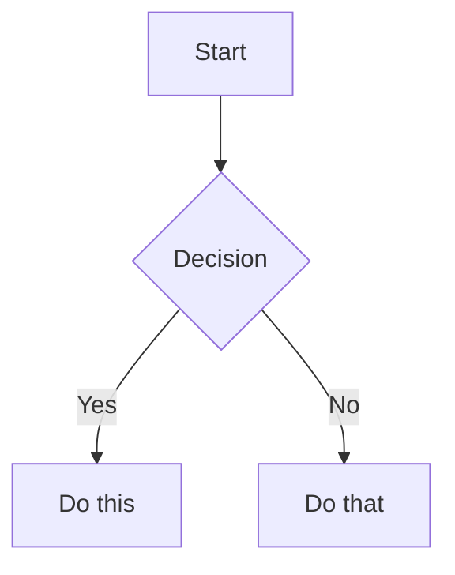

# Syntax Reference

Obsidian extends CommonMark and GFM. Generic Markdown tooling has no equivalent for wikilinks, embeds, callouts, comments and highlights and loses them.

## Tags

```markdown
#tag                    Inline tag
#nested/tag             Nested tag with hierarchy
```

Tags can contain letters, numbers, underscores, hyphens, and forward slashes, but need at least one non-numerical character (`#1984` is invalid, `#1984book` is valid). A space ends a tag, so `#my tag` is the tag `#my`. Tags can also be defined in frontmatter under the `tags` property.

## Comments

```markdown
This is visible %%but this is hidden%% text.

%%
This entire block is hidden in reading view.
%%
```

## Highlight

```markdown
==Highlighted text==
==🔴Highlighted text==                 Colored highlight (Obsidian 1.14.1 and later)
```

A colored highlight starts with 🔴, 🟠, 🟡, 🟢, 🔵 or 🟣 (or the matching square) right after `==`. Other emoji stay as text.

## Tables

When a table follows a paragraph, leave a blank line above it, or it renders as plain text.

## Math (LaTeX)

```markdown
Inline: $e^{i\pi} + 1 = 0$

Block:
$$
\frac{a}{b} = c
$$
```

## Diagrams (Mermaid)

````markdown

````

To link Mermaid nodes to Obsidian notes, add `class NodeName internal-link;`.

## Footnotes

```markdown
Text with a footnote[^1].

[^1]: Footnote content.

Inline footnote.^[This is inline.]
```

## Official documentation

- [Obsidian Flavored Markdown](https://help.obsidian.md/obsidian-flavored-markdown)
- [Internal links](https://help.obsidian.md/links)
- [Embed files](https://help.obsidian.md/embeds)
- [Callouts](https://help.obsidian.md/callouts)
- [Properties](https://help.obsidian.md/properties)
